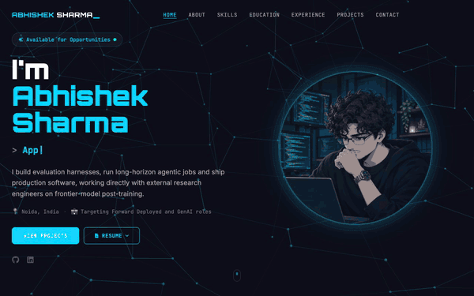
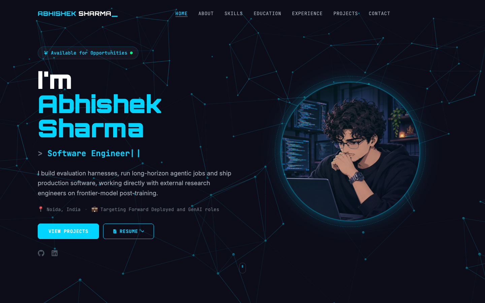
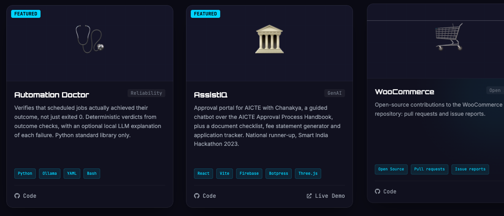
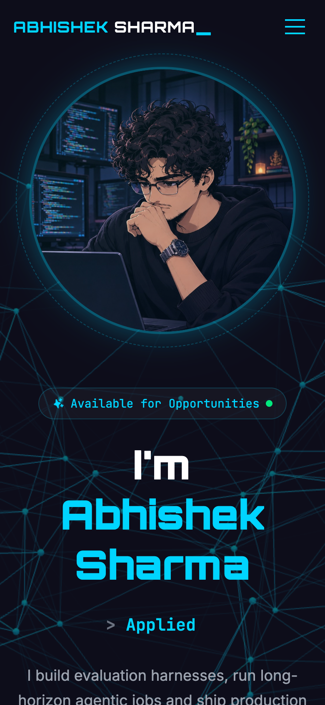
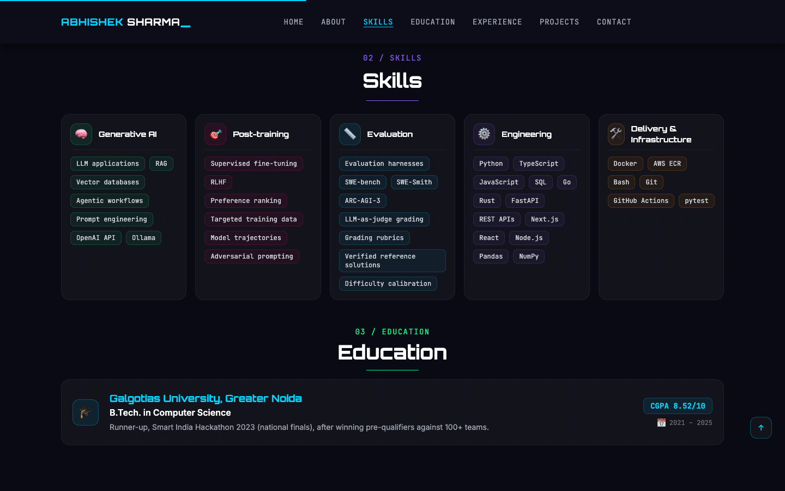
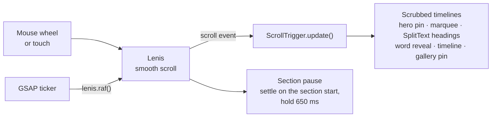

<div align="center">

# Portfolio

**My personal site: a scroll-driven, one-page portfolio built with React, GSAP and Lenis.**



<sub>A real recording of the live site, scrolled with a mouse wheel in headless Chrome.</sub>

**[▶ Open the live site](https://portfolio-abhishek-three.vercel.app)** ·
**[Run it locally](#run-it-locally)** ·
**[How the scrolling works](#how-the-scrolling-works)**


[](LICENSE)

</div>

---

<details>
<summary><b>Contents</b></summary>

- [What's on the page](#whats-on-the-page)
- [Screenshots](#screenshots)
- [How the scrolling works](#how-the-scrolling-works)
- [Run it locally](#run-it-locally)
- [Make it yours](#make-it-yours)
- [Tech stack](#tech-stack)
- [Project structure](#project-structure)
- [Limitations](#limitations)
- [License](#license)

</details>

## What's on the page

- **Hero.** A Vanta.js NET background, a typed role line, the portrait in a round frame, and a **Resume** menu with
  three PDF versions that open in an in-page preview with a download button.
- **About.** Stats that count up, and a bio that lights up word by word as you scroll through it.
- **Skills and Education** on one screen, with skill cards that slide in from alternating sides.
- **Experience.** A timeline line that draws itself as you scroll, with each group's bullets sliding in.
- **Projects.** On desktop the section pins and the cards scroll sideways; on a phone they stack.
- **Contact.** A form that sends through [Web3Forms](https://web3forms.com), plus email, GitHub and LinkedIn links.
- **Small touches:** a short loading screen, a scroll progress bar and a back-to-top button.

## Screenshots

<table>
<tr>
<td colspan="2"></td>
</tr>
<tr>
<td width="62%"></td>
<td width="38%" align="center" rowspan="2"></td>
</tr>
<tr>
<td></td>
</tr>
</table>

<sub>Captured from the live site with headless Chrome: desktop at 1440×900, phone at 390×844.</sub>

## How the scrolling works



- **One clock.** Lenis runs on GSAP's ticker (`gsap.ticker.add(t => lenis.raf(t * 1000))`, lag smoothing off), and
  every Lenis scroll event calls `ScrollTrigger.update`, so animations and scroll position never drift apart.
  Navbar links scroll through `lenis.scrollTo`.
- **Scrubbed, not triggered.** The animations use `scrub: true` and are keyed to their section, so each reveal
  finishes as its section reaches the top of the screen ([`src/lib/scrollAnimations.js`](src/lib/scrollAnimations.js)).
- **Pins in order.** The hero pin is created first and the projects pin last, so each pin's start includes the space
  added by the pins above it.
- **The projects gallery** is a horizontal tween on a pinned section; each card scales in through
  `containerAnimation` as it slides into view. It's desktop only (`min-width: 1024px`).
- **Section pause instead of snapping.** Scrolling stays under the visitor's control. When the scroll crosses the start
  of About, Skills, Experience or Contact, or the start or end of the projects gallery, it settles exactly there and
  holds for 650 ms, then carries on ([`src/lib/sectionSnap.js`](src/lib/sectionSnap.js)). Inside the gallery the cards
  scroll freely. Desktop only.
- **Vanta with an older three.js.** Vanta needs three.js r134, so it gets a pinned alias (`three-vanta`) and renders
  at 1× pixel ratio. The effect is destroyed on unmount.
- **Reduced motion.** With `prefers-reduced-motion`, Lenis, the scroll animations, the section pause and the Vanta
  background are all skipped.

## Run it locally

```bash
git clone https://github.com/abhiishek-sharma/Portfolio.git && cd Portfolio
npm install
npm run dev        # http://localhost:3000, opens the browser
npm run build      # production build in dist/
```

## Make it yours

The page content comes from one file, [`src/config/portfolioData.js`](src/config/portfolioData.js): personal details,
the typed roles, stats, skills, experience, projects, education and contact settings.

- **Resumes:** put the PDFs in `public/resumes/` and list them under `personal.resumes` in the same file; the menu
  ([`src/components/ResumeMenu.jsx`](src/components/ResumeMenu.jsx)) shows each one with a preview and a download.
- **Contact form:** set your Web3Forms access key in `contact.web3formsKey`. Without a key the form only simulates a
  successful send.
- **Colours and fonts:** `tailwind.config.js` and `src/index.css`.

## Tech stack

| Layer | Tools |
|---|---|
| UI | React 19, Vite 8, Tailwind CSS 3, react-icons |
| Scroll and motion | GSAP 3 (ScrollTrigger, SplitText, `@gsap/react`), Lenis, Framer Motion (loader, menus and a few one-time entrances) |
| Background | Vanta.js NET on three.js r134 |
| Components | React Bits: SplitText, CountUp, SpotlightCard |
| Typed role line | react-type-animation |
| Contact form | Web3Forms |
| Hosting | Vercel |

## Project structure

<details>
<summary><b>Folders</b></summary>

```
src/
  sections/      Hero, About, Skills, Education, Experience, Projects, Contact
  components/    Navbar, Footer, Marquee, ResumeMenu, VantaNet, reactbits/ (SplitText, CountUp, SpotlightCard)
  lib/           smoothScroll.js (Lenis), scrollAnimations.js (ScrollTrigger), sectionSnap.js (section pause)
  config/        portfolioData.js, the page content
public/
  resumes/       the three resume PDFs
  profile.jpg    the portrait
Wildest-Dream/   a separate React Three Fiber experiment; not part of the deployed site
```

</details>

## Limitations

- The section pause and the horizontal gallery are desktop features; phones get a normal vertical page.
- The Vanta background is WebGL, so it costs GPU time on low-end machines (it's skipped with reduced motion).
- There are no automated tests; changes are checked by hand in the browser.

## License

MIT. See [LICENSE](LICENSE).
